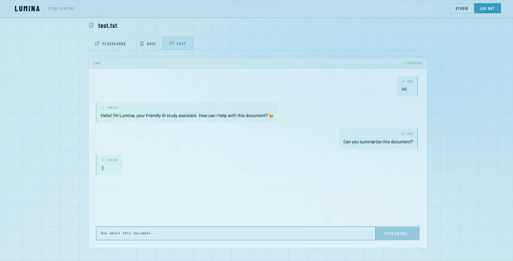
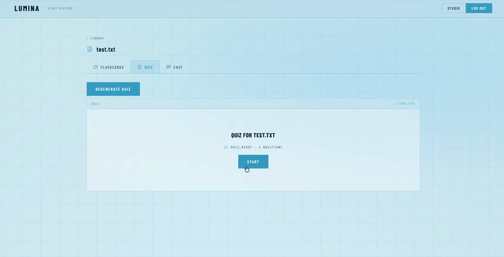
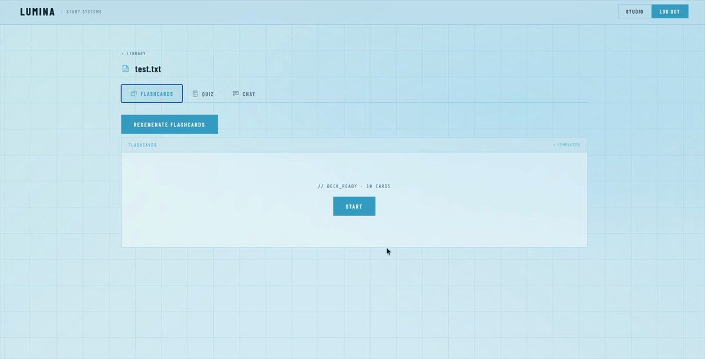

# Lumina

Lumina is an AI-powered study companion that helps users learn from their own
documents. Upload study material, generate quizzes and flashcards, and chat
with documents in real time.

## Features

- Upload TXT, Markdown, PDF, and DOCX files
- AI-generated flashcards and quizzes
- Conversational document chat with SignalR streaming
- Select between configured Gemini models per conversation
- AI-assisted document editing through reviewable proposals
- Structured ProseMirror document operations, including list format changes
- JWT authentication with rotating refresh tokens
- SQLite persistence

## Preview

### AI Chat



Chat with uploaded documents and receive streamed responses.

### Quiz Generation



Generate interactive quizzes from study materials.

### Flashcards



Review AI-generated flashcards for active recall learning.

## Tech Stack

### Frontend

- React + Vite
- React Router
- Tiptap/ProseMirror document editor
- SignalR client (`@microsoft/signalr`)

### Backend

- ASP.NET Core Web API on .NET 10
- Entity Framework Core
- SQLite
- JWT authentication
- SignalR

### AI

Lumina currently uses the Google Gemini API for generation, tool calling,
structured responses, and streamed chat responses.

The backend-controlled model catalog currently contains:

| Internal ID | Gemini API model |
| --- | --- |
| `gemini-flash` | `gemini-3.8-flash` |
| `gemini-3-flash-preview` | `gemini-3-flash-preview` |
| `gemini-flash-lite` | `gemini-3.1-flash-lite` |

Model IDs are validated by the backend. The frontend cannot send arbitrary
Gemini model identifiers.

## Requirements

- [.NET 10 SDK](https://dotnet.microsoft.com/download)
- [Node.js](https://nodejs.org/) 18+ and npm
- A Google Gemini API key
- OpenSSL, for generating a JWT signing key

## Local Setup

### 1. Configure backend secrets

The backend reads local secrets from `backend/Lumina/.env`. This file is
gitignored and must never be committed.

```bash
cd backend/Lumina
cp .env.example .env
```

Set both required values:

```dotenv
Jwt__Key="your-strong-random-secret-at-least-32-characters"
Gemini__ApiKey="your-gemini-api-key"
```

Generate a suitable JWT key with:

```bash
openssl rand -base64 48
```

The Gemini API key stays server-side and is never exposed to the frontend.
Non-secret Gemini settings, including the default model and request timeout,
are stored in `backend/Lumina/Lumina/appsettings.json`.

### 2. Apply database migrations and run the backend

From `backend/Lumina`:

```bash
dotnet ef database update --project Lumina/Lumina.csproj
dotnet run --project Lumina/Lumina.csproj
```

The API listens on:

```text
http://localhost:5131
```

### 3. Run the frontend

In another terminal:

```bash
cd frontend
npm install
npm run dev
```

The frontend runs on:

```text
http://localhost:5173
```

Vite proxies `/api` and `/ws` requests to the backend.

## Gemini Model Selection

The chat model selector loads available models from:

```text
GET /api/ai/models
```

Each conversation stores its selected model. Existing conversations without a
stored preference use the configured default model. Changing the selection
affects subsequent messages and does not interrupt an already-running stream.

The default model is configured in:

```json
{
  "Gemini": {
    "DefaultModel": "gemini-flash"
  }
}
```

## AI-Assisted Document Editing

Document edits are proposed for user approval rather than applied silently.
The AI receives the document structure and stable ProseMirror node IDs before
performing structured edits.

For example, converting a numbered list to bullets changes the list node from
`orderedList` to `bulletList` while preserving its list items and content. It
does not add `-` characters to paragraph text to imitate bullets.

Document renaming is an immediate operation. Other content changes remain
reviewable proposals.

## Ollama Status

Ollama was the original local inference provider. Its service implementation
and DTOs are still present in the repository, but the current application
registers `GeminiService` as the active `IAiService`.

Therefore, starting Ollama alone will **not** make it work with the current
setup. The Docker Compose configuration now targets Gemini and no longer
starts an Ollama container.

Ollama support is intended to be added back through the provider-neutral AI
interface and configuration-based provider selection. Until that work is
completed, use Gemini for the supported local development setup.

## Testing

Run the backend test suite from the repository root:

```bash
dotnet test backend/Lumina/Lumina.Tests/Lumina.Tests.csproj
```

Build the frontend:

```bash
cd frontend
npm run build
```

## Run with Docker

Docker Compose runs the Gemini-backed backend and frontend. The frontend is
available at:

```text
http://localhost:8080
```

From the repository root:

```bash
cp .env.docker.example .env
```

Edit `.env` and set `JWT_KEY` and `GEMINI_API_KEY` to real values, then start
the application:

```bash
docker compose up --build
```

The Gemini API key is injected into the backend container only. Ollama is not
started by the current Compose configuration because the active backend
provider is Gemini.

## Project Structure

```text
backend/Lumina/
  Lumina/              ASP.NET Core application
  Lumina.Tests/        Backend tests
frontend/              React + Vite application
assets/                README preview media
```

## Status

🚧 Work in progress
