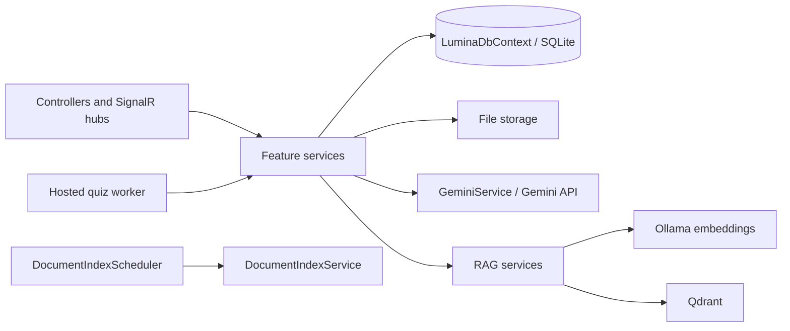

# Lumina backend

This guide describes the implementation in `Lumina/` as it exists today. The API is an ASP.NET Core application; EF Core with SQLite is the system of record, original files and extracted assets live in local file storage, and Qdrant holds derived search vectors.

## Structure and dependencies

- [Program.cs](../Program.cs) configures controllers, SignalR, JWT/Identity, SQLite, CORS, dependency injection, startup migrations/backfill, and index recovery. Authorization is required by default; controllers/hubs can opt out explicitly.
- [Controllers](../Controllers/) are the authenticated HTTP boundary. Document, folder, auth, quiz, flashcard, and chat conversation operations are exposed here. [ChatHub](../WebSockets/ChatHub.cs) streams chat events over SignalR; quiz and flashcard hubs publish their job progress.
- [Services](../Services/) own feature logic. Document services manage content and files, chat services coordinate context and model/tool turns, and RAG services handle indexing and retrieval. Quiz/flashcard services combine AI generation and persisted job state.
- [LuminaDbContext](../Data/LuminaDbContext.cs) maps users, documents, assets, folders, conversations/messages, and quiz/flashcard jobs/results to SQLite. Database migrations run at startup.
- [AI services](../Services/Ai/) separate provider calls from orchestration: `GeminiService` implements `IAiService`; `OllamaEmbeddingService` is used only for vector embeddings. `OllamaService` is an additional provider adapter exposed by the AI API, not the chat provider selected by `ChatService`.

## Workflows

- [Documents and RAG](documents-and-rag.md): upload, content representation, editing, download, deletion, indexing and retrieval.
- [Chat and background work](chat-and-workers.md): prompt/context construction, tool turns, streaming, persistence, and queued generation jobs.

## Configuration

Configuration is loaded from `appsettings*.json`, environment variables, and a traversed `.env` file (loaded before host configuration in `Program.cs`). Environment variables use double underscores, for example `Jwt__Key`.

| Section | Controls | Main consumers |
| --- | --- | --- |
| `ConnectionStrings:DefaultConnection` | SQLite database path | `Program.cs`, EF Core |
| `Jwt` | Issuer, audience, access and refresh lifetimes; signing key comes from secret configuration | JWT setup, `TokenService`; key must be at least 32 characters |
| `Cors:AllowedOrigins` | Browser origins allowed with credentials | CORS policy in `Program.cs` |
| `Gemini` | Provider base URL, default/model catalog, context sizes and timeout | `GeminiService`, `GeminiModelCatalog`, chat budgeter |
| `Ollama` | Embedding endpoint/model and timeout | `OllamaEmbeddingService` |
| `Qdrant` | Vector endpoint, shared collection, timeout | `QdrantVectorStore` |
| `Rag` | Chunk size/overlap, index debounce, retrieval top-K and context/full-document thresholds | Chunker, index scheduler, selector |
| `Chat` | Output-token ceiling and context safety margin | `ChatRequestBudgeter` / orchestration |

Logging uses Serilog via `ILogger<T>`. `Serilog:MinimumLevel` controls base and category levels; the development config enables `Debug` for Lumina, while the base config keeps Microsoft/System logs at `Warning`. Chat request/SignalR logs carry `TraceId` through ambient log context; background jobs use job/document IDs. See [chat logging and observability](chat-and-workers.md#logging-and-observability) for per-request usage and aggregate interaction metrics.

Values in [appsettings.json](../appsettings.json) are defaults, not secrets. The development settings currently only adjust logging. Qdrant and Ollama are external processes and are not provisioned by the API.

## Current boundaries

The index scheduler and quiz/flashcard work queue are in-process. There is no durable broker in this implementation. Chat uses Gemini through `IAiService`; embeddings use Ollama and vectors use Qdrant. PDF and DOCX edits modify Lumina's extracted editable content, not the original uploaded binary. See the workflow docs for the small-document retrieval fallback and index state behavior.
