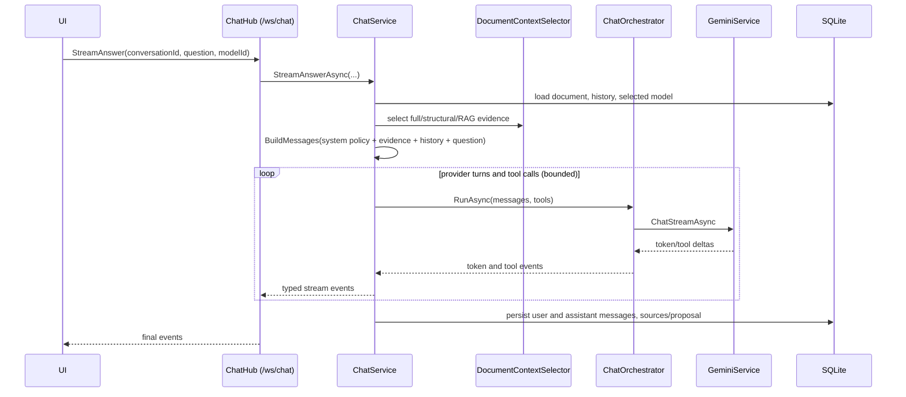

# Chat and background work

## Chat lifecycle

Conversation management is HTTP; answer streaming is a SignalR hub method. The chat is scoped to a document and ownership is checked before the service starts work.

[ChatController](../Controllers/ChatController.cs) creates, lists, loads, selects a model for, and deletes conversations; it also applies/rejects proposals. [ChatHub](../WebSockets/ChatHub.cs) validates question length and document ownership and forwards typed `ChatStreamEvent`s. SignalR cancellation propagates when the client disconnects. [ChatService](../Services/Chat/ChatService.cs) uses short-lived DI scopes for database operations during a potentially long stream, loads history and the conversation model, asks the context selector for bounded evidence, and builds a system prompt that treats retrieved passages as untrusted evidence. Model context budgets are checked by [ChatRequestBudgeter](../Services/Chat/ChatRequestBudgeter.cs).

[ChatOrchestrator](../Services/Chat/ChatOrchestrator.cs) streams Gemini output and handles provider tool calls, with a maximum of five model turns and twenty tool executions, repeated-call blocking, and request-budget checks. Chat tools are executed by `ChatService`; document changes are proposals (with a captured content version) and are applied only after user approval, while rename applies immediately. On completion, the visible answer, user question, optional proposal, and selected sources are persisted; tool chatter is not stored as visible assistant text. Conversation/message models are in [Models](../Models/ChatConversation.cs) and [ChatMessage.cs](../Models/ChatMessage.cs).

## Logging and observability

`TraceIdLoggingMiddleware` pushes ASP.NET Core's current Activity trace ID into Serilog's async `LogContext` for HTTP requests. `ChatHub` applies the same scope for SignalR invocations, preferring the current Activity and falling back to its HTTP connection context. The ambient property flows through asynchronous chat, retrieval, and embedding calls; work outside an HTTP/SignalR context has no `TraceId` and is correlated by its job/document ID instead. No trace ID is manually threaded through service methods.

Each provider call keeps a separate `Chat provider usage` event with `ConversationId`, `ModelId`, `RequestNumber`, input/output/total token counts, and `ToolCallCount`. Usage is recorded once per request (the final usage metadata received for that request) and accumulated by [ChatInteractionMetrics](../Services/Chat/ChatInteractionMetrics.cs). At the end of each enumerated chat interaction, `ChatService` emits one `Chat interaction summary` with `ConversationId`, optional `DocumentId`, `ModelIds`, `ProviderRequests`, token totals, `ToolExecutions`, `DurationMs`, and `Outcome` (`Completed`, `TurnLimitReached`, `Failed`, or `Cancelled`). Partial usage collected before a provider failure/cancellation remains included.

Routine model request starts and retrieval starts are Debug; request completions, provider usage, successful evidence construction, and interaction summaries are Information. Provider/tool failures retain Warning or Error levels. Tool completion logs include `ExecutionNumber`, byte counts and outcome; unexpected exceptions add stable `ErrorCode` and `ExceptionType`, while retryability remains unset when unknown. Tool arguments and prompt/document content are not logged.

The `TraceId` is absent in non-request background work by design. Current failure classification treats a stream that ends without persistence as `Cancelled` when its token is canceled, otherwise `Failed`; provider usage metadata is provider-supplied and may be unavailable.

## Background work

There are two separate in-process mechanisms:

- **Document indexing:** `DocumentIndexScheduler` starts debounced tasks and invokes scoped `DocumentIndexService`; startup recovery reschedules pending, interrupted, unindexed, or version/chunker-stale documents. This mechanism is not a hosted worker or durable queue.
- **Quiz and flashcard generation:** [BackgroundTaskQueue](../Services/Quizzes/BackgroundTaskQueue.cs) is a bounded channel (capacity 100, registered in `Program.cs`). `QuizBackgroundWorker` dequeues and runs work items. `QuizService` and `FlashcardService` persist job state and publish progress through their hubs; a full queue is surfaced as request failure rather than blocking indefinitely. Work items lost during process termination are not recovered from the queue, although their job records are in the database.

The hosted quiz worker implementation is [QuizBackgroundWorker](../Services/Quizzes/QuizBackgroundWorker.cs); generation flows are in [QuizService](../Services/Quizzes/QuizService.cs) and [FlashcardService](../Services/Flashcards/FlashcardService.cs). These jobs are separate from streamed document chat.
