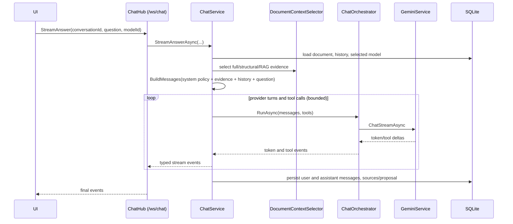

# Chat and background work

## Chat lifecycle

Conversation management is HTTP; answer streaming is a SignalR hub method. The chat is scoped to a document and ownership is checked before the service starts work.

[ChatController](../Controllers/ChatController.cs) creates, lists, loads, selects a model for, and deletes conversations; it also applies/rejects proposals. [ChatHub](../WebSockets/ChatHub.cs) validates question length and document ownership and forwards typed `ChatStreamEvent`s. SignalR cancellation propagates when the client disconnects. [ChatService](../Services/Chat/ChatService.cs) uses short-lived DI scopes for database operations during a potentially long stream, loads history and the conversation model, asks the context selector for bounded evidence, and builds a system prompt that treats retrieved passages as untrusted evidence. Model context budgets are checked by [ChatRequestBudgeter](../Services/Chat/ChatRequestBudgeter.cs).

[ChatOrchestrator](../Services/Chat/ChatOrchestrator.cs) streams Gemini output and handles provider tool calls, with a maximum of five model turns and twenty tool executions, repeated-call blocking, and request-budget checks. Chat tools are executed by `ChatService`; document changes are proposals (with a captured content version) and are applied only after user approval, while rename applies immediately. On completion, the visible answer, user question, optional proposal, and selected sources are persisted; tool chatter is not stored as visible assistant text. Conversation/message models are in [Models](../Models/ChatConversation.cs) and [ChatMessage.cs](../Models/ChatMessage.cs).

## Background work

There are two separate in-process mechanisms:

- **Document indexing:** `DocumentIndexScheduler` starts debounced tasks and invokes scoped `DocumentIndexService`; startup recovery reschedules pending, interrupted, unindexed, or version/chunker-stale documents. This mechanism is not a hosted worker or durable queue.
- **Quiz and flashcard generation:** [BackgroundTaskQueue](../Services/Quizzes/BackgroundTaskQueue.cs) is a bounded channel (capacity 100, registered in `Program.cs`). `QuizBackgroundWorker` dequeues and runs work items. `QuizService` and `FlashcardService` persist job state and publish progress through their hubs; a full queue is surfaced as request failure rather than blocking indefinitely. Work items lost during process termination are not recovered from the queue, although their job records are in the database.

The hosted quiz worker implementation is [QuizBackgroundWorker](../Services/Quizzes/QuizBackgroundWorker.cs); generation flows are in [QuizService](../Services/Quizzes/QuizService.cs) and [FlashcardService](../Services/Flashcards/FlashcardService.cs). These jobs are separate from streamed document chat.
