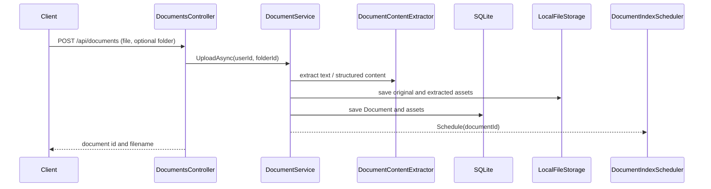
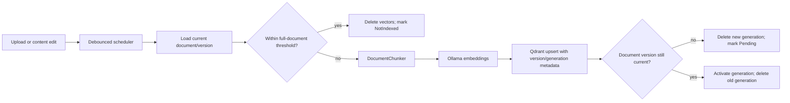

# Documents and RAG

## Document lifecycle

`DocumentsController` is the HTTP boundary (`api/documents`). It passes the authenticated user ID to `DocumentService`, which enforces ownership in queries.

`DocumentValidation` checks upload constraints and `DocumentFormatDescriptor` separates canonical source-text files from structured formats. PDF/DOCX extraction can retain structured content and extracted assets; text/code formats retain source text. The database record stores the editable representation and metadata, while the original upload is stored separately under a generated key by [LocalFileStorage](../Services/Documents/LocalFileStorage.cs). Failed upload cleanup removes files already written.

Editing is handled through `DocumentService.UpdateAsync` (simple content/name updates) and [DocumentEditorService](../Services/Documents/DocumentEditorService.cs) (versioned rich-text operations and exact-range source-text operations). Content edits increment `ContentVersion`, update `UpdatedAt`, and schedule reindexing. Stale expected versions are rejected. Chat-generated edits are stored as pending proposals; see [chat docs](chat-and-workers.md).

Downloads are distinct: `GET /{id}/original` streams the stored upload; `GET /{id}/content` exports current editable content. PDF/DOCX current content downloads as extracted text. Delete first removes vectors, then deletes the database document and attempts original/asset cleanup. A vector cleanup error preserves the database document so deletion can be retried; a failure removing the original can occur after the database row has already been deleted. Routes and behavior are in [DocumentsController](../Controllers/DocumentsController.cs) and [DocumentService](../Services/Documents/DocumentService.cs).

## Indexing pipeline

Indexing is derived data, scheduled after upload/content changes and by the explicit reindex route. [DocumentIndexScheduler](../Services/Rag/DocumentIndexScheduler.cs) debounces repeated changes per document, serializes runs per document, and recovers pending/stale records on startup. It is in-process and not a durable queue.

[DocumentIndexService](../Services/Rag/DocumentIndexService.cs) intentionally writes a new generation before activating it, so retrieval can keep using the old active generation during reindexing. If the document changes during the run, the new generation is discarded. Failures persist `IndexingStatus=Failed` and a truncated error. Documents at or below `Rag:FullDocumentMaxTokens` have old vectors removed and stay `NotIndexed`; chat can use their full text directly. Structured content is chunked with heading paths/node IDs; source-text content uses `ChunkSourceText` with its format-aware path. Embedding inputs include the title and, when available, heading path. [OllamaEmbeddingService](../Services/Rag/EmbeddingService.cs) calls Ollama's `api/embed`; [QdrantVectorStore](../Services/Rag/QdrantVectorStore.cs) stores vectors plus ownership, document/version/generation, and chunk payload.

## Retrieval pipeline

[DocumentContextSelector](../Services/Rag/DocumentRetriever.cs) chooses evidence for the current document and user. It uses full document text when it fits the request evidence budget. For structured documents, an unambiguous heading reference can use structural section retrieval. Otherwise it requires an index whose indexed content version and chunker version match the document, embeds the question, and searches Qdrant using user, document, and active-generation filters. It additionally checks version/generation on results, ranks by score, removes highly overlapping chunks, and caps evidence to budget. Source metadata is returned with semantic/structural evidence.

If the document is too large and the index is absent, stale, or running, retrieval returns a limitation rather than presenting old passages as current. Vector service errors likewise return a failed/no-evidence context. A source list is attached only when retrieval produced sources. Retrieval configuration is in the `Rag` section of [appsettings.json](../appsettings.json).

## RAG execution inspection

Chat requests persist one `RagExecution` row after the stream finishes (or fails after retrieval begins). Its structured details keep initial context selection distinct from retrieval tools invoked later by the model. Tool records include order, strategy, outcome, duration, and candidate/source counts; tool arguments, search queries, and result text are included only when content snapshots are enabled. Per-provider-request input/output/total usage and tool calls are recorded alongside cumulative totals. Source accounting distinguishes initial context sources, tool source occurrences and unique tool sources. A full-document context has zero chunks by design; this does not imply that no later retrieval tools ran. Lumina does not currently emit explicit answer citations, so citation count remains unavailable rather than inferred from retrieved sources. `GET /api/rag/executions` lists only the authenticated user's rows with paging and status, conversation, and date filters; `GET /api/rag/executions/{id}` returns an owned execution. Open **RAG Inspector** from the signed-in navigation to review them.

`Rag:Telemetry:CaptureContent` defaults to `true` so the inspector can show the exact assembled context, tool arguments/results, and answer. These snapshots can contain private document excerpts and user questions; set it to `false` to retain timing and source metadata without those text snapshots. Semantic retrieval records candidate, accepted, and rejected counts; it does not currently expose a reason for each rejected candidate. Provider token counts remain unavailable when the provider omits usage metadata.

When a complete full-document context is supplied, chat instructions now prefer answering from it directly. `get_document_text` is omitted from the available source-text tools for that request because the canonical text is already present; `get_document_structure` remains available for locations, and `search_document` remains available for meaningful targeted discovery. This preserves a way to retrieve focused evidence while avoiding the common full-text reread. When context is partial, pending, or semantic, the text retrieval tool remains available. The instruction discourages redundant search without disabling legitimate follow-up retrieval. The tool-calling loop and transcript behavior are unchanged.
